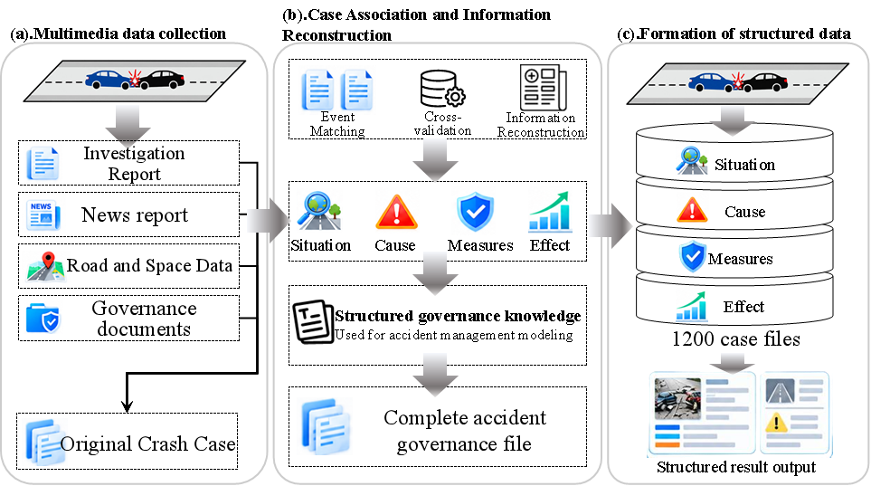
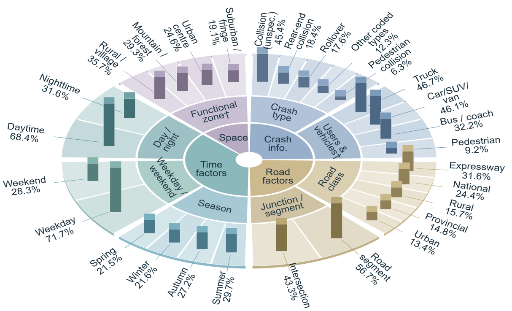

# Multidimensional Crash Governance Dataset

**English** | [简体中文](README_zh-CN.md)

**Linking crash context, contributing factors, and targeted safety countermeasures.**

This repository documents a dataset of **1,200 fatal road crashes in China**. It brings together crash descriptions, temporal and spatial conditions, road design information, cause findings, and available countermeasure records from public sources. The dataset supports research on crash context understanding, cause diagnosis, and safety countermeasure generation.

> **Release status:** The manuscript is currently under peer review. The authors have publicly released a **60-sample subset** of the dataset for reviewers' reference. The full dataset will be released after the paper is published.

[Overview](#overview) · [Construction](#dataset-construction) · [Data sources](#data-sources) · [Data access](#data-access) · [Citation](#citation)

## Overview

| Item | Description |
| --- | --- |
| Cases | 1,200 independent crash events |
| Study area | China |
| Crash inclusion | At least one fatality per crash |
| Case period | 2017–2026 |
| Context dimensions | Basic crash information; temporal characteristics; spatial environment; road design |
| Cause information | Source-supported major causes and separately identified potential risk factors |
| Countermeasure categories | Management and enforcement; road engineering; active safety |
| Outcome information | Documented outcomes and anticipated effects, distinguished where available |
| Research tasks | Context understanding; cause diagnosis; countermeasure generation |

Each case is treated as an independent event. Reports describing the same crash are linked to a single case archive. Field availability varies because public records differ in detail.

The dataset is intended to connect **what happened**, **which causes and risks were identified**, and **which countermeasures were documented or proposed**. It is a retrospective collection of publicly reported cases, rather than a representative sample of all crashes in China.

## Dataset construction



The construction process has three stages:

1. **Collect public records.** Identify candidate crashes and gather investigation reports, news reports, road and spatial information, and countermeasure documents.
2. **Match and verify cases.** Link records using event attributes, cross-check core facts, and reconstruct the case archive.
3. **Organize structured information.** Record crash context, causes and risks, countermeasures, and available outcome information.

Matching uses crash date, location, involved vehicles, crash type, and casualties. Official investigation reports and public authority records are prioritized when sources conflict. Unconfirmed information is retained as missing or uncertain.

## Data sources

**Data sources and their roles in constructing the crash governance dataset**

| Data source | Main information obtained | Primary role |
| --- | --- | --- |
| China Accident Net | Crash date, location, casualties, and basic description | Case identification and initial record collection |
| Police and traffic authority notices | Crash circumstances, involved vehicles, and casualties | Verification of core crash facts |
| Government publications | Investigation findings, remedial requirements, and targeted safety initiatives | Verification of findings and countermeasure records |
| Crash investigation reports | Crash causes, liability determinations, and safety hazards | Authoritative evidence for cause analysis |
| Authoritative news reports | Site conditions, crash background, and subsequent developments | Supplementary information and cross-source verification |
| Maps and road information | Road locations, surrounding environments, and functional areas | Identification of spatial and environmental characteristics |
| Road planning, design, and reconstruction documents | Road classifications, cross sections, safety facilities, and reconstruction details | Identification of road design characteristics |
| Post-crash remedial action reports | Traffic management measures, engineering improvements, and safety facility installations | Extraction of subsequent countermeasures |

<details>
<summary>View the original table figure</summary>


</details>

## Dataset characteristics



The dataset covers multiple crash types, road-user groups, temporal conditions, and road settings. The figure summarizes the distributions reported in the associated study.

**Reading the figure:** Percentages apply to the corresponding variable group. Road-user and vehicle categories may overlap because a crash can involve more than one participant type.

### Information dimensions

| Dimension | Main information |
| --- | --- |
| Basic crash information | Date, location, crash type, road users, vehicles, crash sequence, fatalities, and injuries |
| Temporal characteristics | Season, weekday/weekend, daytime/nighttime, and weather |
| Spatial environment | Urban/suburban/rural setting, land use, and surrounding functions |
| Road design | Road class, design speed/speed limit, cross section, alignment, grade, sight distance, roadside conditions, and protective facilities |
| Causes and risks | Major causes supported by source records; potential contextual risks |
| Countermeasures | Management and enforcement, road engineering, and active safety measures |
| Evidence and outcomes | Supporting sources, available implementation information, documented outcomes, and anticipated effects |

Not every case contains all fields. Missing information should not be interpreted as the absence of a road feature, risk, or countermeasure.

## Supported research tasks

| Task | Input | Target |
| --- | --- | --- |
| Crash context understanding | Cleaned crash narrative | Structured basic, temporal, spatial, and road design information |
| Crash cause diagnosis | Multidimensional crash context | Major causes, potential risk factors, and diagnostic rationale |
| Safety countermeasure generation | Crash context and cause/risk information | Targeted management, engineering, and active safety measures with supporting rationale |

The dataset underpins **Crash Governance LLM (CGLLM)**, a locally deployed model adapted through domain-specific supervised fine-tuning. The associated study examines the connection between crash diagnosis and targeted countermeasure generation.

## Data access

Data files are available in the [data](data/) folder.

## Evidence and interpretation

- Distinguish officially reported causes from potential risks identified through contextual analysis.
- Distinguish planned countermeasures from measures documented as implemented.
- Distinguish expected improvements from observed outcomes.
- Use source records to verify individual case facts and historical countermeasure references.

Agreement with documented remedial actions measures consistency with recorded practice. It does not establish that a recommendation reduces crashes or injuries.

## Associated manuscript

**A Governance-Oriented Framework for Severe Road Crashes: Bridging Crash Diagnosis and Safety Countermeasures With a Multidimensional Crash Governance Dataset**

Kun Qie, Jianyu Wang, Xiaoman Xie, Tinghua Yi, and Xu Zheng.

The manuscript is currently under peer review. A paper link and final publication details will be added after publication.

## Citation

The following is a **provisional dataset citation**. It will be updated when the release receives a permanent identifier.

```bibtex
@misc{qie2026crashgovernancedataset,
  author = {Qie, Kun and Wang, Jianyu and Xie, Xiaoman and Yi, Tinghua and Zheng, Xu},
  title  = {Multidimensional Crash Governance Dataset},
  year   = {2026},
  note   = {Full dataset release and persistent identifier pending}
}
```

## License

The dataset license will be specified with the data release. No open-data license is assigned by this README.

## Contact and corrections

Maintainers: **Kun Qie** (qiekun@stu.bucea.edu.cn) and **Jianyu Wang**, Beijing University of Civil Engineering and Architecture.

For questions, source corrections, or case-matching issues, please open an issue in this repository. Include the affected case identifier when available and the supporting source.

