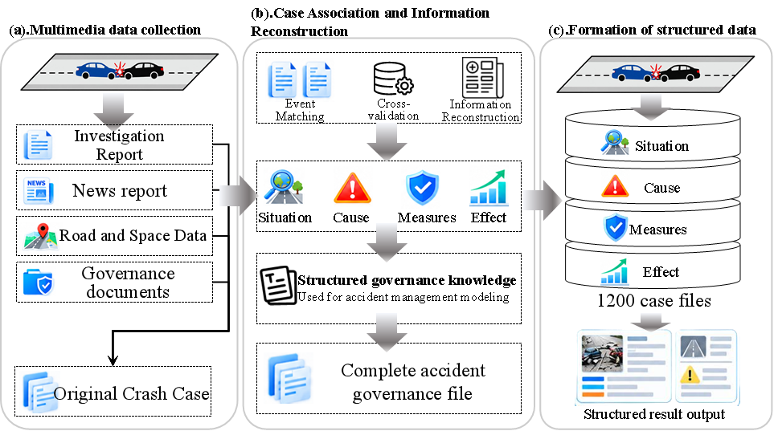
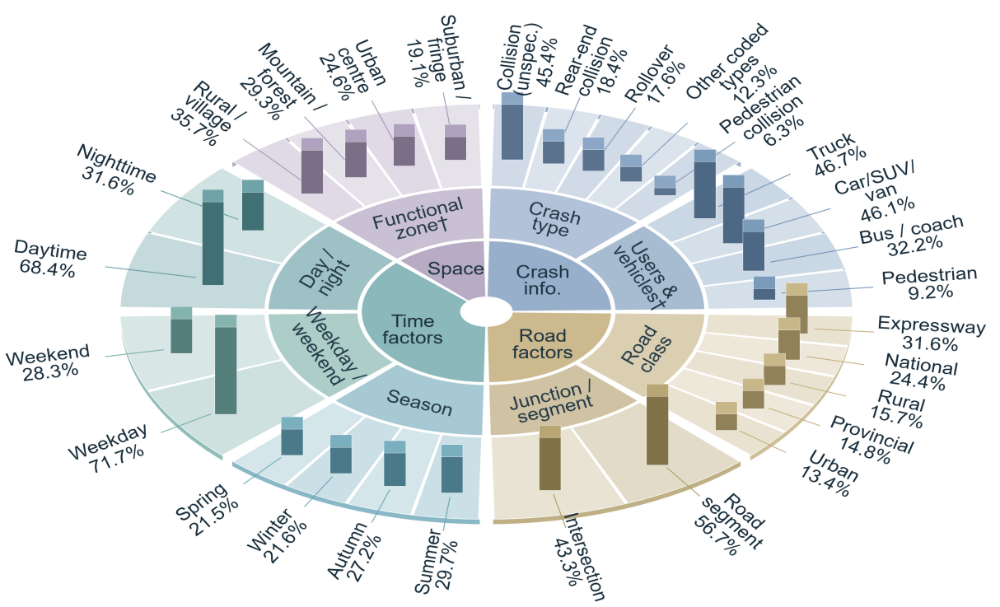

# 多维道路交通事故治理数据集

[English](README.md) | **简体中文**

**关联事故情境、致因因素与针对性安全干预措施。**

本仓库介绍包含**中国1,200起致死道路交通事故**的多维事故治理数据集。数据集整合公开资料中的事故描述、时间条件、空间环境、道路设计信息、致因结论及可获取的治理记录，支持事故情境理解、致因诊断和安全治理措施生成研究。

> **数据获取：** 本仓库提供数据集说明和配图。实际数据文件及永久下载链接将在数据发布时补充。

[数据概览](#数据概览) · [构建流程](#数据集构建) · [数据来源](#数据来源) · [数据获取](#数据获取) · [引用方式](#引用方式)

## 数据概览

| 项目 | 说明 |
| --- | --- |
| 案例数量 | 1,200起独立事故事件 |
| 研究区域 | 中国 |
| 事故纳入标准 | 每起事故至少造成1人死亡 |
| 案例时间范围 | 2017—2026年 |
| 情境维度 | 事故基本信息、时间特征、空间环境、道路设计 |
| 致因信息 | 有来源支持的主要致因，以及单独标注的潜在风险因素 |
| 治理措施类别 | 管理监管、道路工程、主动安全 |
| 效果信息 | 在资料可获取时，区分已记录结果与预期效果 |
| 研究任务 | 情境理解、致因诊断、治理措施生成 |

每起事故作为独立事件组织。同一事故的不同报道关联至同一案例档案。由于公开资料的详细程度不同，各案例的字段完整程度存在差异。

数据集旨在关联**事故发生了什么**、**识别出哪些致因与风险**以及**记录或提出了哪些治理措施**。本数据集是基于公开报道构建的回顾性案例集合，不代表中国全部道路交通事故的总体分布。

## 数据集构建



数据集构建包括三个阶段：

1. **公开资料收集。** 筛选候选事故，收集调查报告、新闻报道、道路与空间信息及治理文件。
2. **事件匹配与事实核验。** 根据事件特征关联不同来源，交叉核实核心事实，重构事故档案。
3. **结构化信息整理。** 记录事故情境、致因与风险、治理措施及可获取的效果信息。

事件匹配依据包括事故日期、地点、涉事车辆、事故类型及伤亡结果。来源信息存在冲突时，优先依据官方调查报告和主管部门公开记录。无法确认的信息保留为缺失或不确定状态。

## 数据来源

**数据来源及其在事故治理数据集构建中的作用**

| 数据来源 | 主要获取信息 | 主要用途 |
| --- | --- | --- |
| 中国事故网 | 事故日期、地点、伤亡及基本经过 | 案例发现与初始记录收集 |
| 公安交警通报 | 事故情况、涉事车辆及伤亡 | 核心事故事实核验 |
| 政府公开文件 | 调查结论、整改要求及专项安全行动 | 调查结论与治理记录核验 |
| 事故调查报告 | 事故原因、责任认定及安全隐患 | 致因分析的权威依据 |
| 权威新闻报道 | 现场情况、事故背景及后续进展 | 信息补充与多源交叉验证 |
| 地图与道路资料 | 道路位置、周边环境及功能区域 | 空间环境特征识别 |
| 道路规划、设计及改造文件 | 道路等级、横断面、安全设施及改造内容 | 道路设计特征识别 |
| 事故后整改报告 | 交通管理措施、工程改善及安全设施建设 | 后续治理措施提取 |

<details>
<summary>查看原始英文表格图片</summary>


</details>

## 数据集特征



数据集覆盖多种事故类型、交通参与者、时间条件及道路环境。上图展示相关研究报告的变量分布。

**读图说明：** 百分比对应各变量组的统计结果。单起事故可能涉及多类交通参与者，因此交通参与者与车辆类别可能存在重叠。

### 信息维度

| 维度 | 主要内容 |
| --- | --- |
| 事故基本信息 | 日期、地点、事故类型、交通参与者、车辆、事故经过、死亡及受伤人数 |
| 时间特征 | 季节、工作日或周末、昼夜及天气 |
| 空间环境 | 城区、城郊或乡村属性，土地利用及周边功能环境 |
| 道路设计 | 道路等级、设计速度与限速、横断面、线形、纵坡、视距、路侧环境及防护设施 |
| 致因与风险 | 来源资料支持的主要致因；事故情境中的潜在风险 |
| 治理措施 | 管理监管、道路工程及主动安全措施 |
| 证据与效果 | 信息来源、可获取的实施信息、已记录结果及预期效果 |

并非每起事故都包含全部字段。信息缺失不应被解释为相应道路设施、风险因素或治理措施不存在。

## 支持的研究任务

| 任务 | 输入 | 目标输出 |
| --- | --- | --- |
| 事故情境理解 | 清理后的事故叙述 | 结构化的事故基本信息、时间、空间及道路设计特征 |
| 事故致因诊断 | 多维事故情境 | 主要致因、潜在风险因素及诊断依据 |
| 安全治理措施生成 | 事故情境与致因、风险信息 | 针对性的管理监管、道路工程及主动安全措施与相应依据 |

本数据集为 **Crash Governance LLM（CGLLM）** 提供数据基础。CGLLM通过本地部署与领域监督微调开展任务适配，相关研究关注事故诊断与针对性治理措施生成之间的衔接。

### 参考数据划分

相关论文采用事故级数据划分：

| 子集 | 事故数量 | 比例 |
| --- | ---: | ---: |
| 训练集 | 960 | 80% |
| 验证集 | 120 | 10% |
| 测试集 | 120 | 10% |
| 合计 | 1,200 | 100% |

数据划分在指令样本构建**之前**完成。同一事故的全部报道与任务样本均保留在同一子集中。案例划分清单将在数据发布时提供。

在诊断评价中，官方致因标签仅作为监督目标或评价参照，不作为测试输入。事故后的整改措施与效果记录也应排除在推理输入之外。评价诊断到治理的完整流程时，应使用模型自身的诊断结果生成建议。

## 数据获取

**发布状态：实际数据文件待上传。**

当前仓库包包含中英文README、构建流程图、特征分布图、数据来源原表图片及数据目录说明，尚未包含事故案例记录。

正式数据发布将补充：

- 数据文件及永久下载地址。
- 字段字典与编码定义。
- 事故级数据划分清单。
- 版本说明、引用信息及数据集许可证。

数据目录的当前状态见 [data/README.md](data/README.md)。

## 证据与结果解释

- 区分官方资料认定的事故原因与情境分析识别的潜在风险。
- 区分拟实施措施与有记录支持的已实施措施。
- 区分预期改善与实际观察结果。
- 依据原始资料核实案例事实及历史治理措施。

与真实整改记录的一致性仅反映建议与已记录治理实践的匹配程度，不能据此认定建议能够减少事故或伤亡。

## 相关论文

**A Governance-Oriented Framework for Severe Road Crashes: Bridging Crash Diagnosis and Safety Countermeasures With a Multidimensional Crash Governance Dataset**

Kun Qie、Jianyu Wang、Xiaoman Xie、Tinghua Yi、Xu Zheng。

论文正在准备中。论文链接及最终出版信息将在确认后补充。

## 引用方式

以下为**暂定数据集引用**，将在数据发布并获得永久标识后更新。

```bibtex
@misc{qie2026crashgovernancedataset,
  author = {Qie, Kun and Wang, Jianyu and Xie, Xiaoman and Yi, Tinghua and Zheng, Xu},
  title  = {Multidimensional Crash Governance Dataset},
  year   = {2026},
  note   = {Dataset release and persistent identifier pending}
}
```

## 许可证

数据集许可证将在数据发布时明确。本README不授予开放数据许可。

## 联系与纠错

维护者：北京建筑大学 **Kun Qie、Jianyu Wang**。

如有问题、来源更正或案例匹配疑问，请在仓库中提交Issue，并尽可能提供相关案例编号及支持资料。
